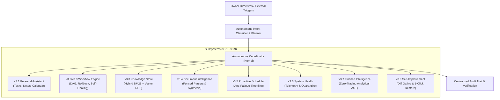

# Autonomous AI Operating System Capstone (v4.0)

v4.0 represents the capstone of Project JARVIS, fusing the modular subsystems developed from v3.1 through v3.9 into a coherent, proactive, and secure AI Operating System.

---

## 1. Architectural Overview

Project JARVIS operates as an autonomous, multi-subsystem operating kernel. Rather than treating capabilities as isolated silos, the v4.0 `AutonomousCoordinator` orchestrates complex, high-level user directives across domain boundaries with unified logging, capability-based security, and truth-preserving observability.

---

## 2. Integrated Subsystem Roster

| Subsystem | Version | Primary Capabilities | Core Invariant |
| :--- | :--- | :--- | :--- |
| **Personal Assistant** | v3.1 | Tasks, notes, reminders, local calendar | Persistent structured memory |
| **Workflow Engine** | v3.2 & v3.8 | DAG compilation, step execution, 4-tier rollback compensation | Truthful status reporting |
| **Knowledge Intelligence** | v3.3 | Hybrid BM25/Vector RRF search, context budgeting | Strict token allocation limits |
| **Research & Document Intelligence** | v3.4 | Multi-format parsing (PDF, DOCX, TXT, MD), structural injection fencing | `<<<UNTRUSTED_DOCUMENT_CONTENT>>>` fencing |
| **Proactive Scheduling** | v3.5 | In-process cron/interval jobs, anti-fatigue alerts | Max 2 concurrent jobs, 15m quiet window |
| **System Health & Reliability** | v3.6 | Telemetry probes, secret scanner, tamper-evident file quarantine | Owner approval for quarantine/restore |
| **Finance Intelligence** | v3.7 | Accounts, auto-categorized transactions, net worth & runway forecasting | Zero trading / broker APIs (AST verified) |
| **Controlled Self-Improvement** | v3.9 | Offline benchmarks, unified diff generation, 1-click snapshot restore | Immutable security path gating |
| **Autonomous OS Capstone** | v4.0 | Unified command routing, multi-subsystem orchestration, system overview | Bounded execution & audit logging |

---

## 3. Autonomous Intent Routing & Execution Flow

The `classify_and_plan` router parses incoming natural language instructions into multi-subsystem collaborative workflows:

### A. Financial Health Assessment (`FINANCIAL_HEALTH_ASSESSMENT`)
- **Subsystems**: Finance & Assistant
- **Execution Flow**:
  1. `finance.accounts.list`: Enumerates active accounts and balances.
  2. `finance.snapshot.generate`: Calculates net worth, cash flow, and runway months.
  3. `assistant.notes.create`: Generates and stores a financial assessment summary note in Assistant memory.
- **Safety**: Purely analytical; absolutely zero trade or payment execution capabilities.

### B. Research & Knowledge Ingestion (`RESEARCH_AND_KNOWLEDGE_INGEST`)
- **Subsystems**: Research, Knowledge, & Assistant
- **Execution Flow**:
  1. `research.documents.parse`: Ingests and fences raw document content.
  2. `knowledge.chunks.ingest`: Chunks and indexes document embeddings via Reciprocal Rank Fusion.
  3. `assistant.tasks.create`: Queues a follow-up review task in the user's task manager.

### C. Proactive Maintenance Sweep (`PROACTIVE_MAINTENANCE_SWEEP`)
- **Subsystems**: Health, Improvement, & Assistant
- **Execution Flow**:
  1. `health.diagnostic.run`: Measures CPU, memory, disk, and scans repository for credential exposure.
  2. `improvement.benchmarks.run`: Runs offline test suites evaluating prompt adherence and safety boundaries.
  3. `assistant.notes.create`: Records diagnostic and benchmark metrics in the assistant audit log.

### D. Proactive Scheduling (`PROACTIVE_SCHEDULING`)
- **Subsystems**: Scheduler & Assistant
- **Execution Flow**:
  1. `scheduler.jobs.create`: Registers background scheduled job under anti-fatigue safeguards.
  2. `assistant.tasks.create`: Logs an oversight task in the assistant.

### E. Dry Run Simulation Mode
- By setting `dry_run=True`, any autonomous request can be simulated without mutating persistent state. Step descriptions and projected impacts are returned with `status="skipped"`.

---

## 4. API Endpoints & Capabilities

| Endpoint | Method | Required Capability | Description |
| :--- | :--- | :--- | :--- |
| `/autonomous/execute` | POST | `AUTONOMOUS_EXECUTE` | Dispatches multi-subsystem autonomous commands. |
| `/autonomous/overview` | GET | `AUTONOMOUS_READ` | Aggregates health, telemetry, and metrics from all 8 subsystems. |
| `/autonomous/history` | GET | `AUTONOMOUS_READ` | Retrieves historical autonomous execution logs. |

---

## 5. Verification & Test Suite

The v4.0 capstone is validated by `tests/test_autonomous_os.py` (9 passed):
- `test_unauthenticated_requests_fail`: 401 challenge enforcement.
- `test_capability_enforcement`: 403 denied capability gating.
- `test_system_overview_operational_status`: Telemetry from all 8 subsystems reported with `system_status="operational"`.
- `test_dry_run_simulation`: Dry-run simulation returns non-mutating preview.
- `test_financial_health_assessment_command`: Successful cross-subsystem execution (finance + assistant).
- `test_research_and_knowledge_ingestion_command`: Successful cross-subsystem execution (research + knowledge + assistant).
- `test_proactive_maintenance_sweep_command`: Diagnostic telemetry + benchmark execution.
- `test_proactive_scheduling_command`: Scheduler job registration + assistant tracking.
- `test_command_history_retrieval`: Audit tracking and per-owner isolation.
